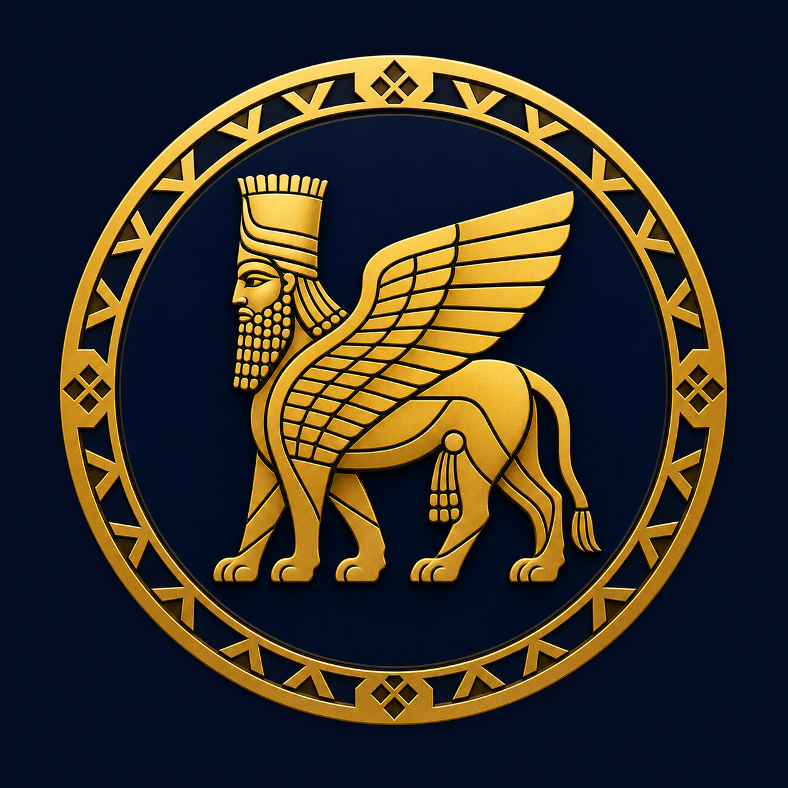

# 🏛️ داریک — سوپر‌اپ ۱۰۰پلن (DARIC Super App)

> **Capital App** — سوپر‌اپ مالی مبتنی بر توکن NAV‌محور **DARIC** با ۱۳ سرویس میکروسرویس، ۴ قرارداد هوشمند و داشبورد RTL فارسی.

<p align="center">
  
</p>

## ✨ ماژول‌ها

| دسته | ماژول‌ها |
|---|---|
| **توکن و NAV** | توکن DARIC (عرضه ۱B) · محاسبه NAV از گزارش دارایی · اوراکل ۲-از-۳ + IPFS · Hash گزارش قابل تأیید |
| **DeFi** | صرافی دفتر سفارش (limit/market, عمق ۲۰ سطح) · P2P با اسکرو Vault (فقط DARIC/SHARE) · کیف پول چندارزی + Timelock 48h · طلا/نقره با اسپرد ۰.۵٪ + تسویه فیزیکی |
| **مالی** | وام تا ۸۰٪ LTV با قفل متناسب وثیقه و آزادسازی هر قسط · دفتر حسابداری دوطرفه با Hash-Chain و Idempotency |
| **باشگاه** | پورسانت ۳ سطحه (۲۵/۱۲/۶٪) · تایر برنز/نقره/طلا/الماس · درخت زیرمجموعه · override توسط ادمین |
| **بازی و سرگرمی** | گردونه ۱۰ خانه Provably-Fair · آرشا گیم · تکاوُ لیزرتگ · کلاب/کازینو |
| **سبک زندگی** | گردشگری (تور + پرداخت چندارزی) · بیمه (۴ دسته) · چت پشتیبانی ۱-به-۱ |
| **امنیت و ادمین** | OTP + KYC با تشخیص چهره · 2FA · RBAC (View/Edit/Approve) · CMS Maker-Checker · Audit Log · Bug Bounty (Immunefi) |

## 📦 ساختار مخزن

```
├── contracts/                  # ۴ قرارداد سالیدیتی
│   ├── DaricToken_Military.sol       # ERC-20 + blacklist/freeze + سقف روزانه بتا
│   ├── DaricNAV_Oracle_Military.sol  # اوراکل NAV با امضای ۲-از-۳ + IPFS
│   ├── DaricTimelock.sol             # تایم‌لاک ۴۸ ساعته + dual-approval
│   └── DaricVault.sol                # خزانه امانی + escrow P2P + ReentrancyGuard
├── packages/
│   ├── shared/src/             # منطق مشترک: nav, orderbook, ledger, commissions,
│   │                           #   loan, calculators, wheel, tiers, coa, types
│   ├── eventbus/src/           # Redis Streams + request/reply ساغا
│   └── database/               # Prisma schema تک‌فایلی همه ماژول‌ها
├── services/                   # ۱۳ سرویس
│   ├── nav-service/       :4005 # محاسبه/تأیید NAV
│   ├── oracle-service/    :4015 # IPFS + امضای ۲-از-۳
│   ├── wallet-service/    :4030 # HD wallet + صف برداشت + سقف بتا
│   ├── exchange-service/  :4010 # OrderBook + P2P + کارمزد ۰.۲٪/۰.۱٪
│   ├── gold-silver-fund/  :4020 # طلا/نقره + تسویه فیزیکی + NFT رسید
│   ├── loan-service/      :4040 # وام ۸۰٪ LTV + وثیقه متناسب + cron
│   ├── accounting-service/:4050 # دفتر Hash-Chain + تراز آزمایشی
│   ├── mlm-service/       :4060 # پورسانت ۲۵/۱۲/۶ + تایرها
│   ├── user-service/      :4070 # OTP + KYC + 2FA
│   ├── game-service/      :4080 # گردونه Provably-Fair
│   ├── tourism-service/   :4090 # تور + پرداخت چندارزی
│   ├── insurance-service/ :4100 # محصولات/بیمه‌نامه/مطالبات
│   └── admin-service/     :4110 # RBAC + CMS + Audit
├── dashboard/                  # داشبورد Next/Vite — RTL فارسی، تم navy×gold
│   └── src/{pages,pages2,lib}   # ۲۱ صفحه: داشبورد، NAV، صرافی، P2P، کیف پول،
│                                #   طلا، وام، باشگاه، بازی، گردشگری، بیمه،
│                                #   چت، تنظیمات + ۵ صفحه ادمین
├── assets/                     # لوگوی رسمی توکن + بنر
├── deployment/                 # docker-compose ۱۵ سرویس + monitoring/alerts.yml
├── security/
│   ├── bug-bounty/POLICY.md          # Immunefi — تا ۲۵,۰۰۰$ Critical
│   └── launch/beta-config.json       # ۲۰۰ دعوت · سقف ۵۰۰$/روز · KPI
├── e2e/cross-module-flow.spec.ts     # تست گردش کامل بین‌ماژولی
└── scripts/                    # beta-launch.sh + verify-all.sh
```

## 🚀 اجرا

```bash
# داشبورد (پیش‌نمایش محلی)
cd dashboard && npm install && npm run dev    # → http://localhost:5173

# استقرار کامل (۱۳ سرویس + Postgres + Redis)
cp deployment/.env.prod.example deployment/.env.prod   # پر کردن secretها از Vault
docker compose -f deployment/docker-compose.yml up -d

# تست E2E
npx playwright test e2e/

# لانچ بتا
bash scripts/beta-launch.sh
```

## 💰 توکنومیک داریک

- **عرضه کل:** ۱,۰۰۰,۰۰۰,۰۰۰ DARIC (۱۸ اعشار، ثابت — بدون mint)
- **قیمت:** NAV کل دارایی‌ها ÷ عرضه — هر گزارش با **SHA-256** روی **IPFS** و امضای **۲-از-۳** اوراکل
- **فرمول NAV:** (سرمایه + املاک + منقول + پروژه‌ها + در حال ساخت + فیزیکی) × ضریب رشد لگاریتمی
- **کارمزد صرافی:** ۰.۲٪ — **نصف با پرداخت داریک** (۰.۱٪)
- **پورسانت باشگاه:** L1=۲۵٪ (نامحدود) · L2=۱۲٪ · L3=۶٪ — از ۵ دسته رویداد

## 🛡️ امنیت

- OWASP 10/10 · Rate-limit سه‌لایه · PII با KMS envelope
- دفتر با **Hash-Chain** — هر دستکاری → `CHAIN_BROKEN`
- برداشت: KYC L2 + 2FA + Whitelist + سقف روزانه + **Timelock 48h** + دو-تصدیقی بالای ۱۰K$
- قراردادها: ReentrancyGuard · pause اضطراری · Blacklist/Freeze · audit Slither+Mythril
- **Bug Bounty:** Immunefi — پول اولیه ۵۰,۰۰۰$ USDC

## 📱 منوی اصلی کاربر

```
🏠 داشبورد | 💼 سرمایه‌گذاری | 🚀 استارتاپ‌هاب | 🎮 آرشا گیم | 🔫 تکاوُ لیزرتگ
💳 کیف پول | 🤝 شبکه (MLM) | 🏦 وام‌ها | ⚙️ تنظیمات
```

---

**داریک** — دارایی واقعی، شفافیت روی‌چین · daric.fund · v1.0.0-beta
